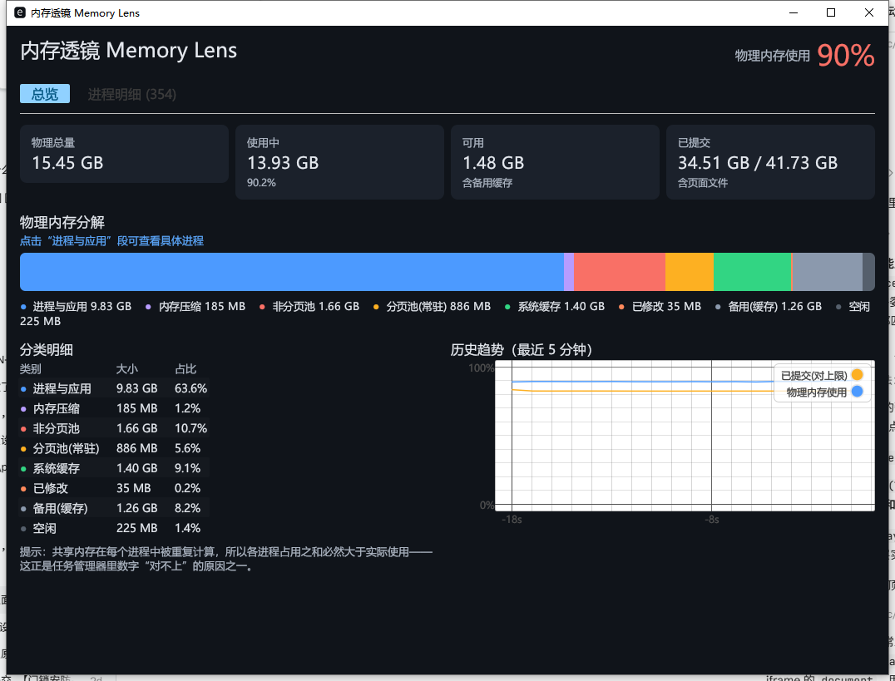
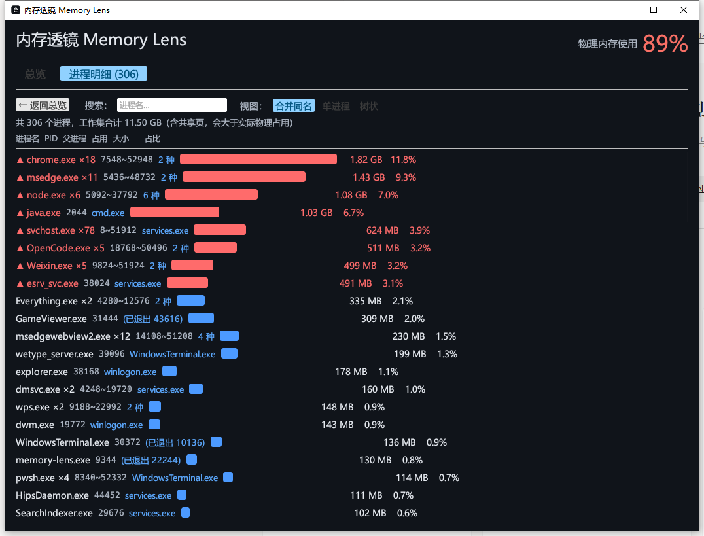

# Memory Lens / 内存透镜

Memory Lens 是一个面向 Windows 的内存可视化与 SPD 分析工具，使用 Rust、egui/eframe 构建，结合 WMI/SMBIOS、RAMSPDToolkit 和 spdr 展示内存硬件信息、JEDEC/XMP/EXPO 时序以及内存吞吐和延迟测试结果。

A Windows memory visualization and SPD analysis tool built with Rust and egui.



## 功能

- **内存总览**：物理内存总量、使用量、可用量、提交量、分页/非分页池、系统缓存和历史趋势。
- **进程明细**：按进程查看工作集、搜索、合并同名、单进程、树状视图，以及进程命令行和终止操作。
- **内存条信息**：通过 WMI/SMBIOS 读取容量、插槽、频率、厂商、型号、序列号、电压等字段。
- **SPD 详细时序**：
  - DDR3/DDR4 使用 RAMSPDToolkit 1.6.4 的 JEDEC 时序字段。
  - DDR5 使用 `spdr` 解析 JEDEC / XMP 3.0 / EXPO 预设。
  - 显示 CRC 校验状态、核心时序、tCK、tRFC、tFAW、tRRD、tWTR 等参数。
  - 新版界面提供 Thaiphoon Burner 风格的“内存模块 / DRAM 组件”双栏信息和速度档位表。
- **两种显示风格**：顶部可切换“新版 / 经典”，默认新版；经典模式保留紧凑表格和预设切换。
- **内存测速**：顺序读取、写入、复制吞吐，以及指针追逐内存延迟；新版使用 AIDA64 风格的矩阵结果表。

> L1 / L2 / L3 缓存层级测试尚未纳入当前版本。界面会明确标注这一限制，不填充虚假数据。

## 界面截图

| 总览 | 进程明细 |
|---|---|
|  |  |

## 系统要求

- Windows 10/11 x64
- .NET Framework 4.7.2 或更高版本（运行 SPD 桥接；Windows 10/11 通常已包含 4.8）
- 读取 SPD 时需要管理员权限和 PawnIO 驱动
- 构建时需要：
  - Rust stable（MSVC toolchain）
  - .NET SDK（用于构建 `spd-bridge`）
  - Windows 10/11 SDK（`build.rs` 需要资源编译工具）

SPD 功能使用随程序嵌入的官方 PawnIO 2.2.0 安装程序，不引入额外的驱动依赖。安装前会校验嵌入文件的 SHA-256 和 Authenticode 签名；程序不会使用 unrestricted 版本，也不会绕过驱动安装流程。PawnIO 服务安装后常驻，可通过 Windows“已安装的应用”卸载。

## 构建

```powershell
cargo check --all-targets
cargo test
cargo build
```

`cargo build` 会通过 `build.rs` 自动执行 `dotnet restore --locked-mode` 和 `dotnet publish`，将 SPD 桥接程序嵌入主程序。因此首次构建需要可用的 .NET SDK 和 NuGet 包缓存/网络。

也可以单独构建 C# 桥接程序：

```powershell
dotnet build spd-bridge/MemoryLens.SpdBridge.csproj -c Release --no-restore --nologo
```

## 运行

```powershell
target\debug\memory-lens.exe
```

发布构建：

```powershell
cargo build --release
target\release\memory-lens.exe
```

普通的内存总览和进程信息不需要管理员权限。使用“内存信息 → 读取详细时序”时，请以管理员身份运行程序；首次读取可能触发官方 PawnIO 安装程序，安装完成后可能需要重启以清理旧驱动服务。

## 数据来源与可信度

- 内存容量、频率、序列号等基础字段来自 WMI/SMBIOS 的固件报告值，不是实时总线测量。
- SPD 预设（JEDEC / XMP / EXPO）是内存条固件中的配置档位，不代表当前运行时频率。
- SPD CRC 不匹配会显示警示，但不会阻止查看时序和原始数据。
- 测速结果是本进程在当前机器上的实测吞吐/延迟，受 CPU、缓存、后台负载和电源策略影响，不等同于理论带宽或稳定性测试。
- 不会用猜测值填充分辨率未知的字段；缺失字段统一显示“未提供”或“—”。

## 真机验证状态

已在以下环境完成 DDR5 实机验证：

- PawnIO 2.2.0
- Kingbank 16 GB DDR5，i801 SMBus，SPD 地址 `0x51`
- JEDEC：`40-40-40-77`，`DDR5-4800`，CRC 通过
- EXPO：`36-38-38-86`，`DDR5-6000`，CRC 通过
- 序列号与 WMI 记录匹配，插槽关联为 `Controller0-ChannelB-DIMM1`

尚未完成：

- DDR3/DDR4 实机验证（当前只有合成数据单元测试）
- DDR4 XMP 2.0 解析
- 多根内存条的真实切换与插槽关联验证
- L1/L2/L3 缓存层级基准测试

## 项目结构

```text
src/
  main.rs          # 应用入口和全局样式
  app.rs           # 主界面、总览和进程视图
  sys.rs           # 进程、物理内存和系统快照
  memory.rs        # WMI 硬件信息、内存测速、延迟测试
  memory_page.rs   # 内存信息页面、经典/新版 UI
  spd.rs           # SPD 文档模型、DDR3/DDR4/DDR5 时序解析、CRC
spd-bridge/
  Program.cs       # RAMSPDToolkit <-> Rust 的 JSON 桥接
  LocalPawnIO.cs   # PawnIO 用户态接口
  PawnIOService.cs # 官方 PawnIO 安装器封装
doc/
  elektra-star-lord-animal-man.md  # 开发方案与真机验证记录
licenses/          # 第三方组件许可与声明
```

## 开发命令

```powershell
cargo fmt --all
cargo check --all-targets
cargo test
cargo build
dotnet build spd-bridge/MemoryLens.SpdBridge.csproj -c Release --no-restore --nologo
```

Rust 侧当前包含 7 个单元测试，覆盖 SPD CRC、纳秒/周期换算、CL 支持列表校验、混插汇总和插槽匹配。

## English Summary

Memory Lens is a Windows-only memory inspector and SPD analysis tool.

Highlights:

- Physical memory overview, process breakdown, and historical memory usage.
- WMI/SMBIOS module details, including serial numbers and slots.
- Real SPD timing for DDR3/DDR4 via RAMSPDToolkit and DDR5 JEDEC/XMP/EXPO via `spdr`.
- Modern and classic UI modes, with a Thaiphoon-style speed-bin table.
- Memory read/write/copy throughput plus pointer-chasing latency, presented in an AIDA64-style table.

Build and run:

```powershell
cargo build
target\debug\memory-lens.exe
```

SPD reading requires administrator privileges and installs the pinned, signed PawnIO 2.2.0 driver through its official installer. DDR3/DDR4 hardware and DDR4 XMP 2.0 are not yet hardware-validated.

The project is released under the MIT License. Bundled third-party components remain under their respective licenses; see `licenses/` for details.

## 许可

本项目采用 [MIT License](LICENSE)。

随项目分发或使用的第三方组件仍受其各自许可约束，详见 [`licenses/THIRD_PARTY_NOTICES.txt`](licenses/THIRD_PARTY_NOTICES.txt) 和 `licenses/` 目录。特别是随程序提供的 PawnIO 安装程序/驱动组件按其 GPLv2+ 及项目声明的例外条款单独授权。
